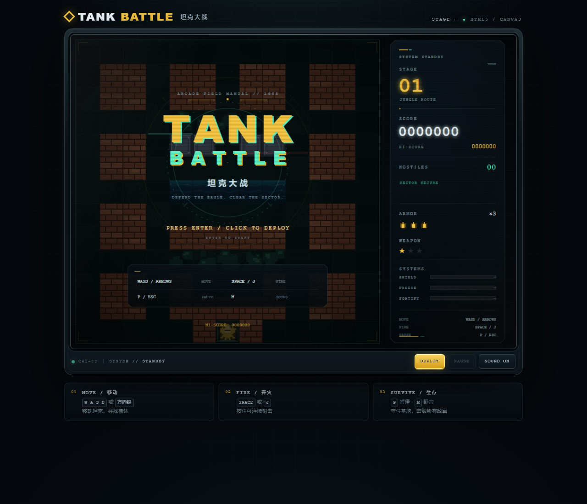
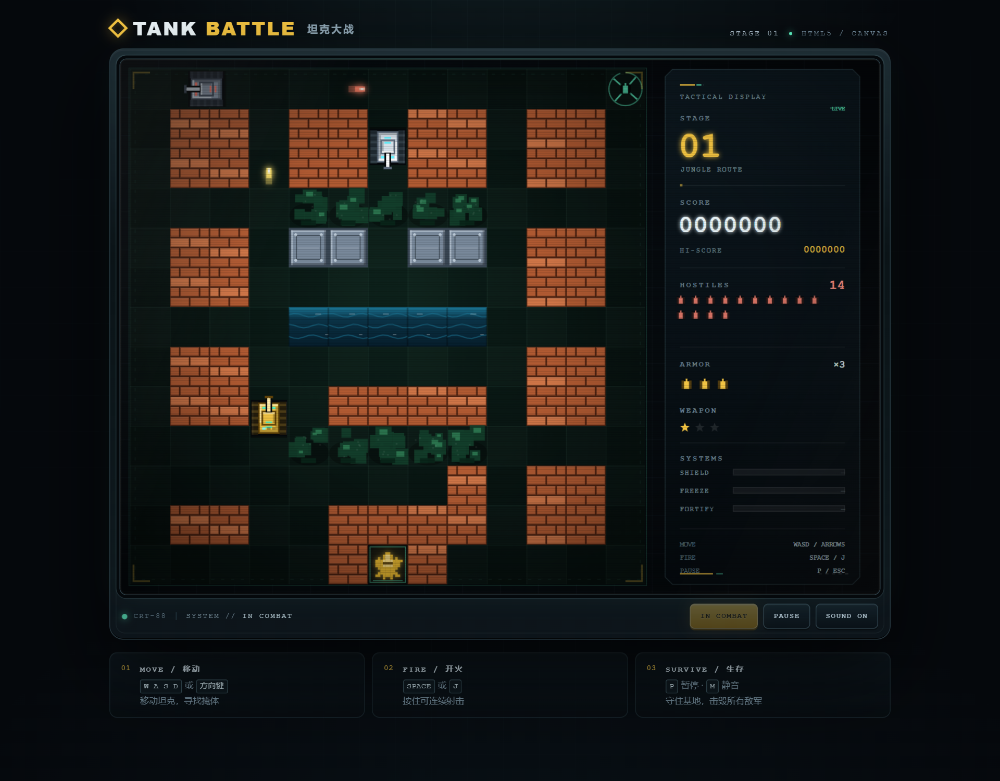

<div align="center">



# TANK BATTLE · 坦克大战

**一款打开即玩的霓虹复古坦克大战。纯 HTML5 Canvas + 原生 JavaScript，无依赖、无构建步骤、无外部素材。**

[🎮 在线试玩](https://yifu-xuwu.github.io/tank-battle/) · [💻 源代码](https://github.com/Yifu-xuwu/tank-battle) · [🐛 反馈问题](https://github.com/Yifu-xuwu/tank-battle/issues)

</div>

---

## 游戏简介

敌军坦克正从三个方向涌入战场。驾驶你的金色坦克，穿过砖墙、河流与丛林，击毁所有入侵者，并守住底部的金鹰基地。

清空一个战区后自动进入下一关。地图循环使用，但敌军数量、速度与装甲会持续增强——看看你能守住多少个战区。



## 特色

- **单文件游戏**：所有画面、音效、关卡与逻辑都在 `index.html` 中，双击即可开玩。
- **街机手感**：像素风坦克、炮弹拖尾、爆炸粒子、屏幕震动与 CRT 扫描线。
- **3 张手工地图**，分别拥有丛林、冰港、铁厂三种视觉主题。
- **4 种敌军坦克**：普通、侦察、炮手、重装甲，AI 会朝玩家与基地推进并开火。
- **6 种补给道具**：武器升级、护盾、全屏轰炸、额外生命、时间冻结、基地钢墙。
- **完整游戏循环**：开始界面、暂停、战区结算、无限关卡、最高分本地保存。
- **全合成音效**：使用 Web Audio API 实时合成，不需要加载任何音频文件。
- **多端适配**：桌面端键盘操作；手机和平板自动显示触屏方向键与开火键。

## 操作

| 动作 | 键盘 | 触屏 |
| --- | --- | --- |
| 移动 | `W A S D` / `方向键` | 左下方向键 |
| 开火 | `Space` / `J`（可按住连射） | 右下 **FIRE** |
| 暂停 / 继续 | `P` / `Esc` | 工具栏 **PAUSE** |
| 静音 / 恢复声音 | `M` | 工具栏 **SOUND** |
| 开始 / 重试 | `Enter` / 点击画面 | 点击画面或 **DEPLOY** |

## 玩法规则

- 玩家共有 **3 条生命**，被击毁后会在基地左侧重生，并获得短暂护盾。
- 基地被摧毁或生命耗尽即游戏结束。
- 每击毁 4 辆敌军会出现一辆闪烁的 **BONUS 坦克**，击毁后掉落补给。
- 武器升级共 3 级：2 级获得双发炮弹，3 级炮弹可以击穿钢墙。
- 每张地图的砖墙均可被炮弹摧毁，合理利用墙体保护基地。
- 清空当前战区会获得关卡奖励分，之后自动进入下一关。

## 道具

| 道具 | 效果 |
| --- | --- |
| ⭐ 星章 | 武器等级 +1；满级后获得额外分数 |
| 🪖 头盔 | 获得 8 秒护盾 |
| 💣 手雷 | 立即消灭场上所有敌军 |
| 🚚 坦克 | 生命 +1 |
| 🕐 时钟 | 冻结敌军 7 秒 |
| 🪏 铲子 | 基地周围砖墙强化为钢墙 12 秒 |

## 本地运行

无需安装任何依赖：

```bash
# 方式一：直接用浏览器打开
start index.html        # Windows
open index.html         # macOS

# 方式二：启动本地静态服务器（推荐）
python -m http.server 8000
# 然后访问 http://localhost:8000
```

## 文件结构

```text
.
├── index.html        # 游戏本体（HTML / CSS / Canvas / JS）
├── README.md
├── LICENSE
└── docs/
    ├── menu.png      # 主菜单截图
    └── preview.png   # 游戏截图
```

## 技术说明

- 使用 `<canvas>` 2D API 绘制全部视觉内容，没有图片或字体文件。
- 逻辑分辨率 `920 × 648`，战场为 `13 × 13` 个格子，适配高 DPI 屏幕。
- 游戏循环基于 `requestAnimationFrame`，固定逻辑步长上限，移动与碰撞使用逐步推进避免穿透。
- 支援 `prefers-reduced-motion`、键盘焦点样式与 `aria-live` 状态提示。
- 最高分使用 `localStorage` 保存，不收集任何用户数据。

## 许可

本项目基于 [MIT License](LICENSE) 开源。欢迎 Star、Fork 和提交改进。
